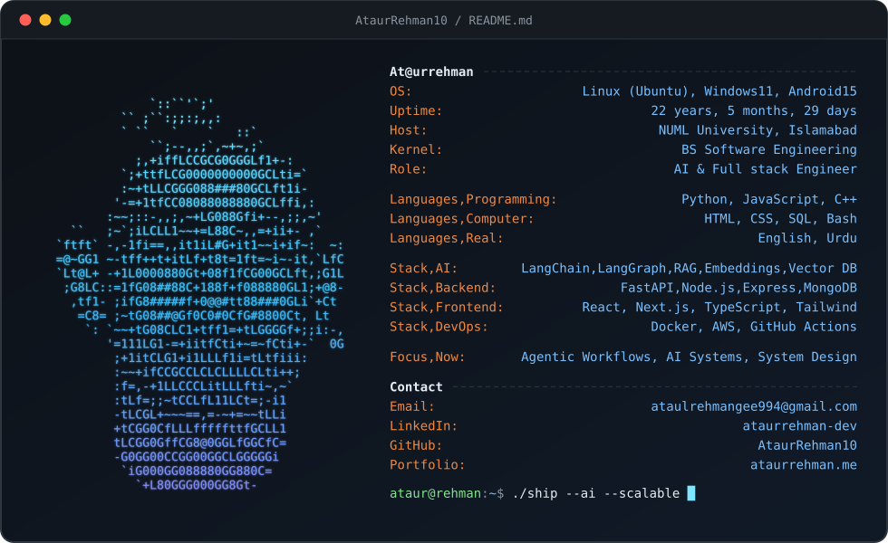

---

## 🧑‍💻 About Me

<!-- Neofetch-style card with ASCII portrait (see /scripts to regenerate) -->  

---

## 🛠️ Tech Stack

### 💻 Frontend

### ⚙️ Backend

### 🗄️ Databases

### ☁️ DevOps & Tools

### 🧠 Languages

---

## 🐍 FUN Graph 
  

---

## 🌐 Connect With Me

